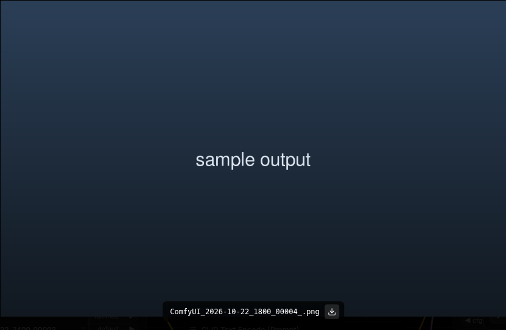

# ComfyUI Asset Filename Caption

Shows the **file name** in ComfyUI's full-screen media lightbox, with a
**download button** for the file you are looking at.

Pure DOM. No core patch, no frontend fork — it is a frontend-only custom node that
serves one JS file through ComfyUI's `WEB_DIRECTORY`, the same supported mechanism
every UI-only node pack uses.



## The problem

Double-clicking a thumbnail in the **Assets** sidebar (also **Job History** and the
**Queue** gallery) opens `MediaLightbox.vue`: a black overlay with the image and
prev/next arrows. It renders the image through `ComfyImage` with
`alt = <file name>`, but never draws that text — and it has no download control.
So once you are zoomed into an image there is nothing on screen telling you which
file it is, and no way to save it without leaving the view.

No setting controls either in frontend **1.55.18** or upstream `main` (**1.57.x**,
checked 2026-10-21).

## Install

**ComfyUI Manager** → *Custom Nodes Manager* → **Install via Git URL** →
`https://github.com/smhc/ComfyUI-AssetFilenameCaption`

or manually:

```bash
cd ComfyUI/custom_nodes
git clone https://github.com/smhc/ComfyUI-AssetFilenameCaption.git
```

or download the release ZIP and extract it so the folder lands in `custom_nodes/`.

Then **restart ComfyUI** (it scans `custom_nodes` at boot) and hard-refresh the
browser tab (Ctrl+Shift+R) — the extension list is cached per page load.

Verify: `<comfy>/api/extensions` lists
`/extensions/ComfyUI-AssetFilenameCaption/filename_caption.js`.

**Updating needs no restart.** `/extensions/<name>/<file>.js` is served from disk
per request, so after `git pull` (or copying a new file in) a hard-refresh is
enough.

## What it does

- Watches `<body>` for the teleported lightbox root (`div[role="dialog"][data-mask]`)
  — childList plus `src`/`alt` attribute changes, coalesced with `setTimeout`.
- Reads `img[alt]` inside it. If the value is not `ComfyImage`'s default
  (`Image content`), appends a bottom-centre caption: the file name plus a download
  button.
- The button is a plain `<a>` whose `href` is the lightbox image's own `src` and
  whose `download` is the file name. That src is
  `apiURL('/view?' + {filename, type, subfolder})` — the **original stored file**,
  not a `preview=` transcode — and it is same-origin, so the browser saves the real
  bytes under the exact name.
- The overlay wrapper is `pointer-events: none`; only the button re-enables them,
  and its `mousedown`/`mouseup`/`click` are stopped so the dialog's click-to-close
  and arrow-key handlers never see them. Downloading leaves the lightbox open.
- Arrow-key navigation, and any in-place image swap, re-sync the name, `href` and
  `download`. Closing the lightbox removes the caption; nothing is injected when it
  is closed.

## Notes and limits

- **Images only.** Video/audio/text results render different components with no
  `img[alt]`, so nothing is injected for them.
- The download button relies on the `download` attribute, which browsers ignore for
  cross-origin URLs. ComfyUI serves `/view` from the same origin, so this holds; it
  would not for a remote/CDN asset URL.
- Only the name `<span>` is `aria-hidden` (the image `alt` already conveys it); the
  button stays in the accessibility tree with `aria-label`/`title`
  `Download <file name>`. The label is English — a frontend extension has no access
  to the app's i18n instance.
- Coalescing is `setTimeout`, not `requestAnimationFrame`: rAF callbacks do not run
  while the document is hidden (background tab, minimised window), which would
  leave the overlay missing.

## Uninstall

Delete the folder and restart ComfyUI. Nothing else is touched.

## If upstream adds this

Then delete this extension. Check
`src/components/sidebar/tabs/queue/MediaLightbox.vue` in
[Comfy-Org/ComfyUI_frontend](https://github.com/Comfy-Org/ComfyUI_frontend) before
assuming the gap still exists.

## License

MIT
